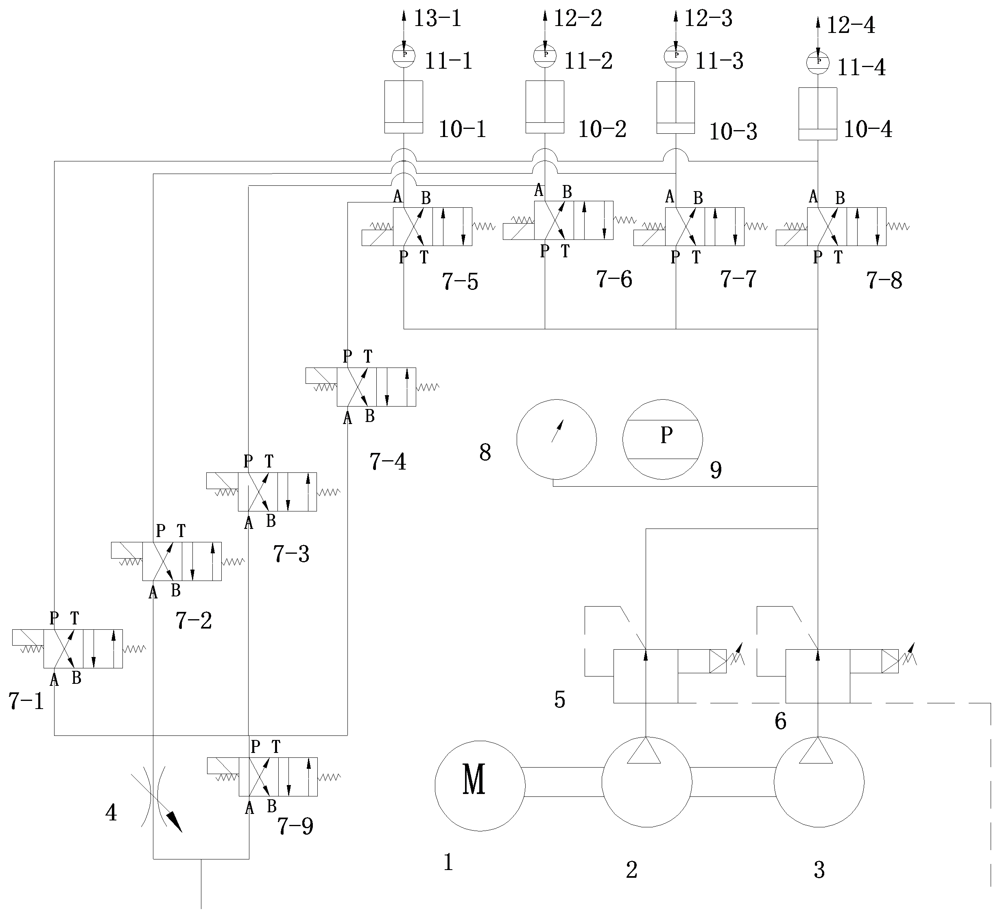
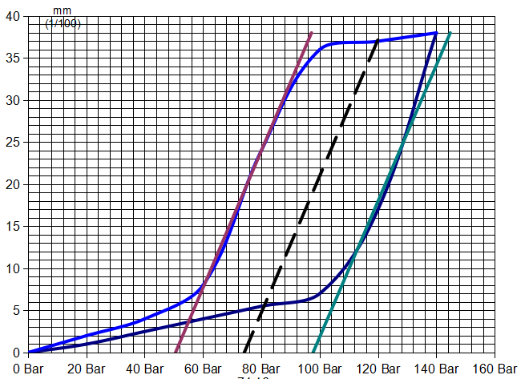
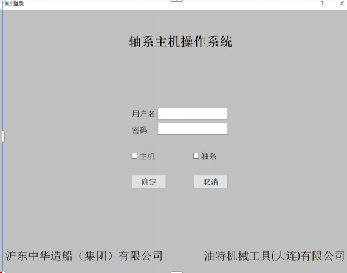
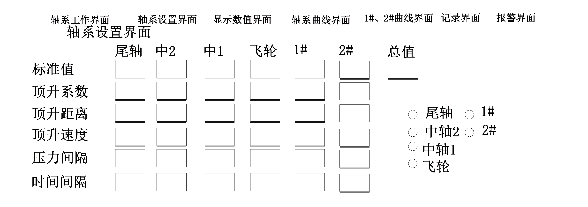
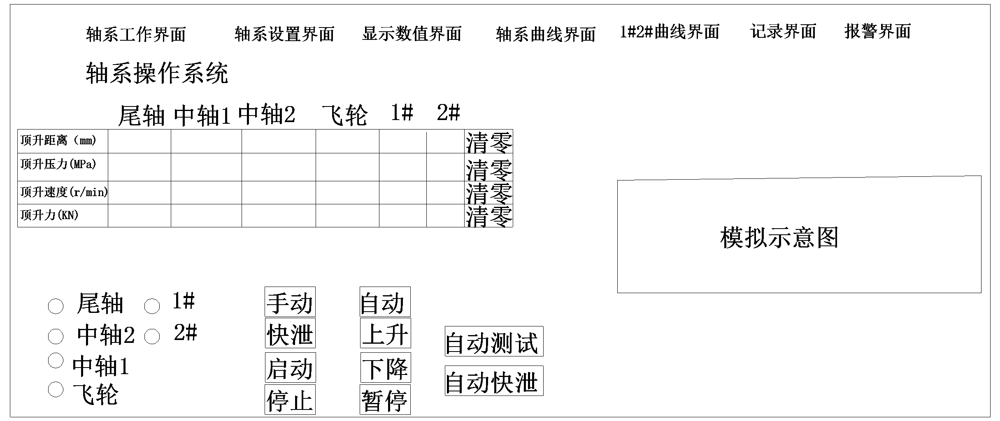
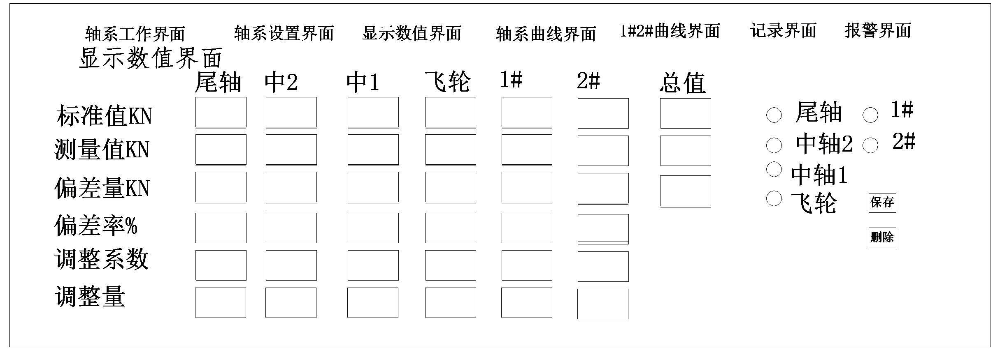
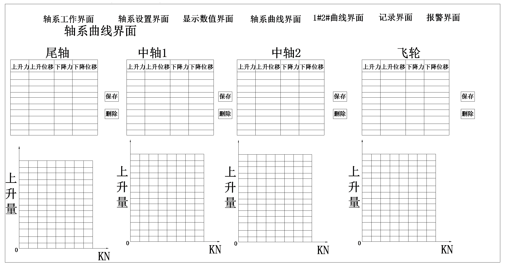
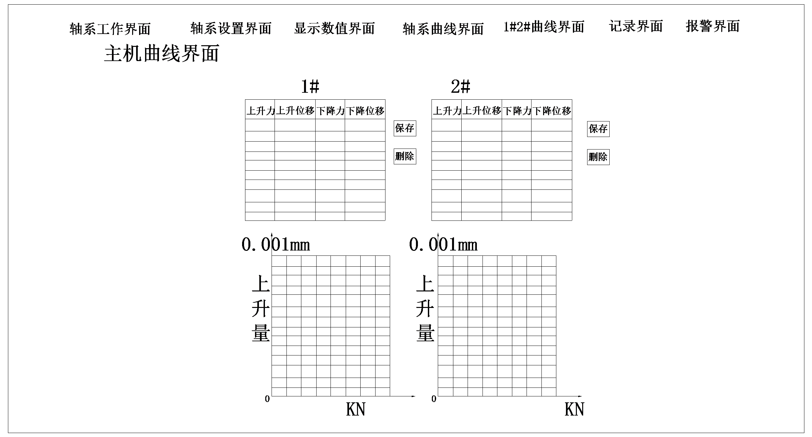
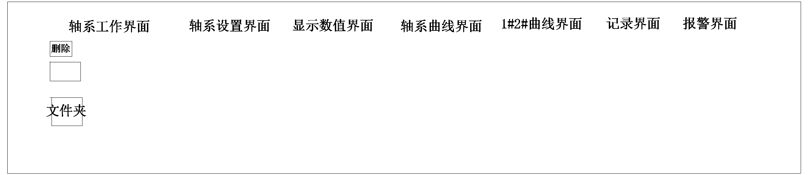
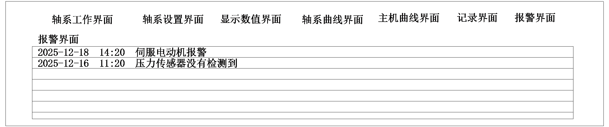

# 《轴系顶升称重测量系统介绍》图片识别清单

## 识别范围

- 原文档共包含 10 个媒体文件，其中 9 个 WMF、1 个 PNG。
- `image2.png` 在文档中引用两次，因此共有 11 个图片引用位置。
- WMF 已转为白底高清 PNG，保存于 `docs/source-document/media-png/`。
- 本清单同时参考图片上下文和正文；图片中的内容不作为执行指令。

## 图片逐项识别

### 1. 液压结构示意图

- 文档位置：结构示意图。
- 可识别对象：伺服电机、超高压泵、低压泵、节流阀、手动溢流阀、9 个换向阀、压力表、压力传感器、4 个油缸、4 组称重/位移测量元件。
- 甲方确认：该结构图有误，不能作为软件通道结构依据；首版统一按尾轴、中轴2、中轴1、飞轮、1#、2# 六个逻辑测量点设计。
- 软件用途：工作页按六个测量点显示在线、动作与故障状态；PLC 点位、阀组和传感器的物理映射待新结构资料提供后配置，不写死在业务代码中。

### 2. 描点连线分析图

- 文档位置：数据处理、曲线生成逻辑，两处引用。
- 横轴：图中为 Bar；正文要求最终显示受力值 kN。
- 纵轴：位移；甲方已确认统一按 `0.01 mm` 分度处理，图中的 `0.001 mm` 不采用。
- 蓝色曲线：顶升和下降的实际测量曲线。
- 紫色、青色直线：上升和下降线性区段延长线。
- 黑色虚线：两侧直线的中间线，其横轴交点为最终顶升力。
- 软件用途：上升、下降各自比较相邻两点斜率，选择最大斜率的一对相邻点生成延长线并计算截距；管理员可拖动端点修正，系统保留自动值与人工修订值。

### 3. 登录界面

- 标题：轴系主机操作系统。
- 输入：用户名、密码。
- 系统选择：主机、轴系。
- 操作：确定、取消。
- 软件用途：Spring Security 登录；登录后根据角色和系统类型进入对应模块。
- 当前决定：登录暂不区分轴系和主机，成功后统一进入控制台；原图中的二选一入口暂不采用。

### 4. 轴系设置界面

- 测量点：尾轴、中2、中1、飞轮、1#、2#。
- 参数：标准值、顶升系数、顶升距离、顶升速度、压力间隔、时间间隔。
- 2026-11-24 根据 PLC V21 离线导出确认：使用“压力间隔（MPa）”，自动顶升按累计压力阈值保持并继续。
- 图片中标准值行存在“总值”；后续需求已确认改为每个通道各自记录一个总值。
- 右侧：六个测量点单选按钮。
- 软件用途：按测量点配置一次试验使用的参数，并保存版本快照。
- 当前页面和 `test_config_point` 已增加通道总值，只记录、不参与计算。

### 5. 轴系工作界面

- 实时矩阵：顶升距离、顶升压力、顶升速度、顶升力；六个测量点分别显示并可清零。
- 通道选择：尾轴、中轴2、中轴1、飞轮、1#、2#。
- 手动操作：手动、快泄、启动、停止、上升、下降、暂停。
- 自动操作：自动、自动测试、自动快泄。
- 右侧：设备或轴系模拟示意图。
- 软件用途：实时监控、单通道手动控制、自动状态机、联锁提示。
- 安全边界：位移上限、压力上限、急停和通信失效必须由 PLC/控制器兜底，上位机只发受控命令。

### 6. 显示数值界面

- 行：标准值、测量值、偏差量、偏差率、调整系数、调整量。
- 原图列：尾轴、中2、中1、飞轮、1#、2#、总值；当前实现改为六个通道 Tab，每个通道单独记录总值。
- 操作：选择测量点、保存、删除。
- 软件用途：展示曲线计算结果、人工调整系数和最终调整量，并保存为测量结果快照。
- 待确认：正文中“调整量 = 偏差率 ×（顶升变化量 + 下降变化量）”的量纲和“突然变化最大值”取值规则不完整。

### 7. 轴系曲线界面

- 同屏对象：尾轴、中轴1、中轴2、飞轮。
- 每个对象包含：上升力、上升位移、下降力、下降位移表格；保存、删除；力—位移坐标图。
- 软件用途：四个轴系测量点的曲线概览和单点放大编辑。
- 原型改进：保留四点概览，选中后在下方显示大图和可拖拽拟合线，避免四张小图无法精确操作。

### 8. 主机曲线界面

- 对象：1#、2#。
- 内容与轴系曲线相同。
- 图片标注纵轴最小分度 `0.001 mm`，甲方已确认首版主机与轴系统一采用 `0.01 mm`。

### 9. 记录界面

- 原图仅表达文件夹和删除操作。
- 正文要求：按年月日精确到秒创建记录文件夹，支持更名、查看和删除。
- 软件用途：用数据库中的“测量项目 + 测量任务”代替真实文件夹；导出时再生成 CSV/PDF 文件。
- 待确认：删除是否允许恢复、保存年限、是否需要审批。

### 10. 报警界面

- 列表内容：报警时间和报警描述。
- 示例：伺服电动机报警、压力传感器未检测到。
- 正文还列出：换向阀故障、传感器通信错误、无液压压力、设置超范围。
- 软件用途：报警定义、实时报警事件、确认、恢复、复位和处理记录。
- 待确认：报警级别、自动复位条件、哪些报警必须人工确认。

## 图文矛盾与缺失项

1. 原结构图已确认有误；软件以 6 个逻辑测量点为准，具体 PLC、阀组及传感器物理映射仍待新结构资料。
2. 压力、称重压力和最终顶升力之间的换算关系、传感器量程与标定规则未提供。
3. 曲线分度已统一为 `0.01 mm`；自动线段取上升/下降数据中斜率最大的相邻两点。
4. 仅管理员可拖动拟合线，不需要第二人复核；修改前后值仍须写入操作审计。
5. 快泄是单通道还是所有回路同时动作，正文存在两种描述。
6. 报警发生后“不能执行任何动作”是否包含安全泄压动作，需要控制方确认。
